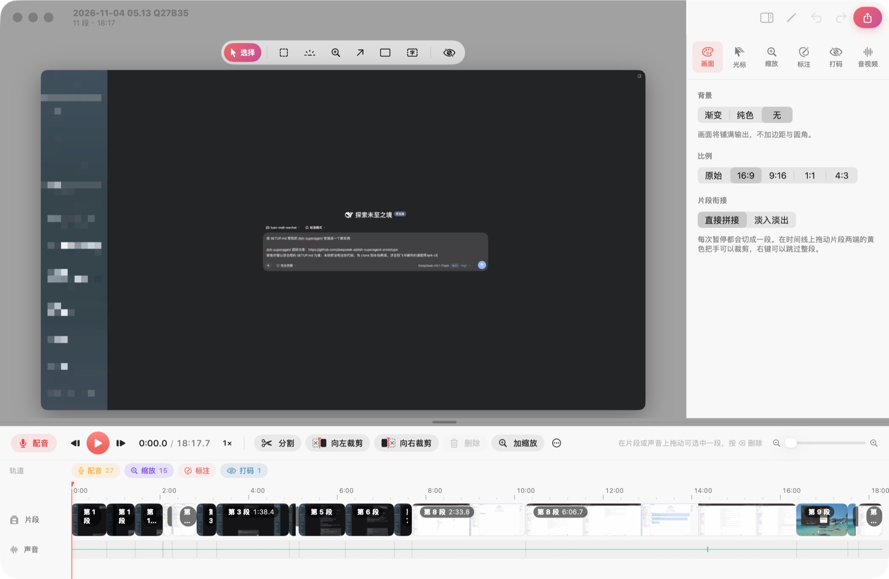

<div align="center">


# Takes

**为自媒体和教程作者打造的 Mac 录屏软件**

说错了不用从头录：随时暂停、只重录这一段；录完自动放大、一键打码、边看边配音。

[**下载最新版**](https://github.com/ai-suifeng/takes/releases/latest/download/Takes.zip) · [官网](https://ai-suifeng.github.io/takes/) · [更新记录](https://github.com/ai-suifeng/takes/releases)

免费开源（MIT） · 支持 Apple 芯片和 Intel · macOS 15 及以上

</div>



## 为什么用 Takes

录教程最怕录到一半说错一句，只能从头再来。Takes 把一次录制拆成很多段，哪里错了就只重录哪里；录完的画面、光标、缩放、打码和配音都可以事后修改，原始录像始终不变。

### 四个核心功能

| | 功能 | 说明 |
|---|---|---|
| ⏸ | **随时暂停** | 按 ⌥⌘P 暂停，画面变灰提示「没有在录制」；每次暂停自动切成一段。说错了按 ⌥⌘Z 只重录这一段，前面录好的都保留。 |
| 🔍 | **放大缩小** | 按点击位置自动放大并平滑跟随；也可以在时间线上拖出要放大的时间段，在画面上框选放大区域，观众能看清每个细节。 |
| 🙈 | **一键打码** | 马赛克、模糊、色块三种样式，区域可跟随内容移动；本地扫描画面里的邮箱、手机号、身份证、银行卡、密钥、IP，一键全部打码。 |
| 🎙 | **边看边配音** | 画面没有声音？在编辑器里按 R，一边播放一边录麦克风，声音和画面逐帧对齐；之后剪掉画面，配音会跟着一起走。 |

### 其他功能

- **录制**：全屏、窗口或任意区域；同时录系统声音、麦克风和摄像头（画中画）；开始前倒计时；录制时可隐藏指定 App 和系统通知。
- **好看的成片**：重绘光标（平滑移动、放大、静止时隐藏、点击波纹），背景渐变或纯色、圆角、阴影，16:9 / 9:16 / 1:1 / 4:3 画面比例，段与段之间淡入淡出，屏幕上显示按键。
- **剪辑**：像剪映一样在时间线上拖动选中一段直接删除；在播放头处分割、向左 / 向右裁剪，对视频、配音、缩放、标注、打码各条轨道都有效；撤销、重做；0.5×–2× 倍速预览。
- **讲解标注**：录制时按住 Fn 点按钮，自动画出贴合按钮的高亮框和 ①②③ 编号；录制中按 ⌥⌘D 用画笔、荧光笔、箭头、矩形现场标注。
- **声音增强**：自动把讲解音量调到适合发布的响度，带压缩、限幅和降噪。
- **资料库**：按日期整理所有录制，可收藏、加标签，还能按画面里出现过的文字搜索；意外退出或断电后自动恢复未完成的录制。
- **导出**：MP4 或 GIF，导出后自动拷贝到剪贴板，可以直接粘贴到聊天或社交平台。

## 下载与安装

1. **下载**：点击 [Takes.zip](https://github.com/ai-suifeng/takes/releases/latest/download/Takes.zip)，或到 [Releases](https://github.com/ai-suifeng/takes/releases) 页面选择版本。
2. **安装**：双击解压，把 `Takes.app` 拖进「应用程序」文件夹。
3. **第一次打开**：Takes 目前没有经过 Apple 公证，第一次打开时 macOS 会拦截。请按下面的方法放行（只需要做一次）：
   - 双击打开 Takes，在弹出的提示里点「完成」；
   - 打开「系统设置 → 隐私与安全性」，滚动到底部，在 Takes 那一行点「仍要打开」，再输入密码确认。
4. **授权**：按 Takes 的引导打开「屏幕录制」权限，然后重新打开 Takes。「辅助功能」（点击框选、按键显示）、「麦克风」和「摄像头」按需开启。

> 如果提示「Takes 已损坏，无法打开」，这是下载时被系统加上了隔离标记。在「终端」里执行下面这行后再打开：
>
> ```sh
> xattr -dr com.apple.quarantine /Applications/Takes.app
> ```

**系统要求**：macOS 15 Sequoia 或更新版本，Apple 芯片或 Intel 处理器均可。

## 快速上手

1. 点菜单栏里的 Takes 图标或按 **⌥⌘R**，选择录全屏、窗口或区域，开始录制。
2. 说错了就按 **⌥⌘P** 暂停，再按 **⌥⌘Z** 重录这一段；按 **⌥⌘R** 结束录制。
3. 录制结束后自动打开编辑器：在时间线上删掉不要的部分，加缩放、打码、配音。
4. 点右上角的导出按钮（**⌘E**），选择 MP4 或 GIF。

## 快捷键

**全局**

| 快捷键 | 作用 |
|---|---|
| ⌥⌘R | 开始 / 结束录制 |
| ⌥⌘P | 暂停 / 继续 |
| ⌥⌘Z | 重录这一段（暂停时：删除上一段） |
| ⌥⌘D | 录制中打开标注工具 |

**编辑器**

| 快捷键 | 作用 |
|---|---|
| 空格 | 播放 / 暂停 |
| ← → / ⇧← ⇧→ | 逐帧 / 逐秒移动 |
| S | 在播放头处分割 |
| Q / W | 向左裁剪 / 向右裁剪 |
| I / O | 选区从播放头开始 / 到播放头结束 |
| ⌫ | 删除选区或选中的内容 |
| Z | 在播放头处添加缩放 |
| R | 开始配音；配音中再按 R 或空格结束 |
| ⌥⌘I | 显示 / 隐藏右侧设置面板 |
| ⌘Z / ⇧⌘Z | 撤销 / 重做 |
| ⌘E | 导出 |

选中配音、缩放、标注或打码时，分割和裁剪只作用于选中的那一项，不会动到视频。

## 常见问题

**收费吗？**
免费。

**录像存在哪里？会上传吗？**
默认保存在「影片 / Takes」文件夹，每次录制是一个 `.takes` 文件夹，可以在设置里修改位置。录像、文字识别和敏感信息扫描都只在你的电脑上进行，不会上传。Takes 唯一的联网行为是每天检查一次 GitHub 上有没有新版本。

**怎么更新？**
Takes 每天自动检查一次新版本，有更新时弹窗提示，点「立即更新」会自动下载、校验签名、安装并重启。也可以在菜单栏图标里点「检查更新…」。

**录完还能改缩放、光标和打码吗？**
能。这些都是录完之后作为编辑信息加上去的，随时可以修改或删除，原始录像不会被改动。

**为什么画面录不到 / 一片黑？**
请确认「系统设置 → 隐私与安全性 → 屏幕录制」里已勾选 Takes，勾选后需要重新打开 Takes。

**怎么卸载？**
退出 Takes，把「应用程序」里的 Takes 移到废纸篓即可。录像保存在「影片 / Takes」，需要的话手动删除。

## 反馈

遇到问题或有功能建议，欢迎在 [Issues](https://github.com/ai-suifeng/takes/issues) 里提出。请尽量附上 macOS 版本、Takes 版本（设置 → 通用 → 当前版本）和复现步骤。

## 参与开发

从源码构建、发布新版本、项目结构和自测方法，见 [开发说明](docs/DEVELOPMENT.md)。

## 许可证

Takes 以 [MIT 许可证](LICENSE) 开源：可以免费使用、修改和再分发，包括商业用途，只需保留版权和许可声明。
